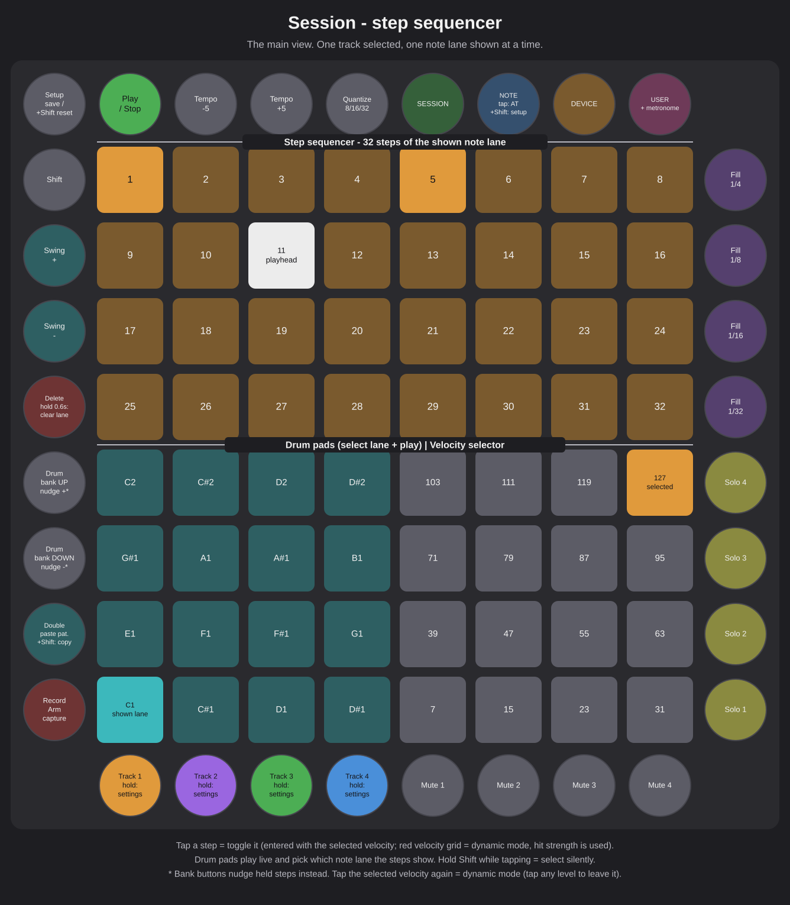
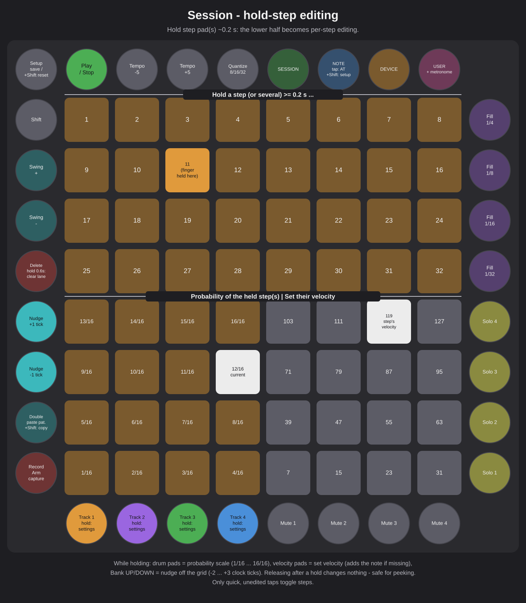
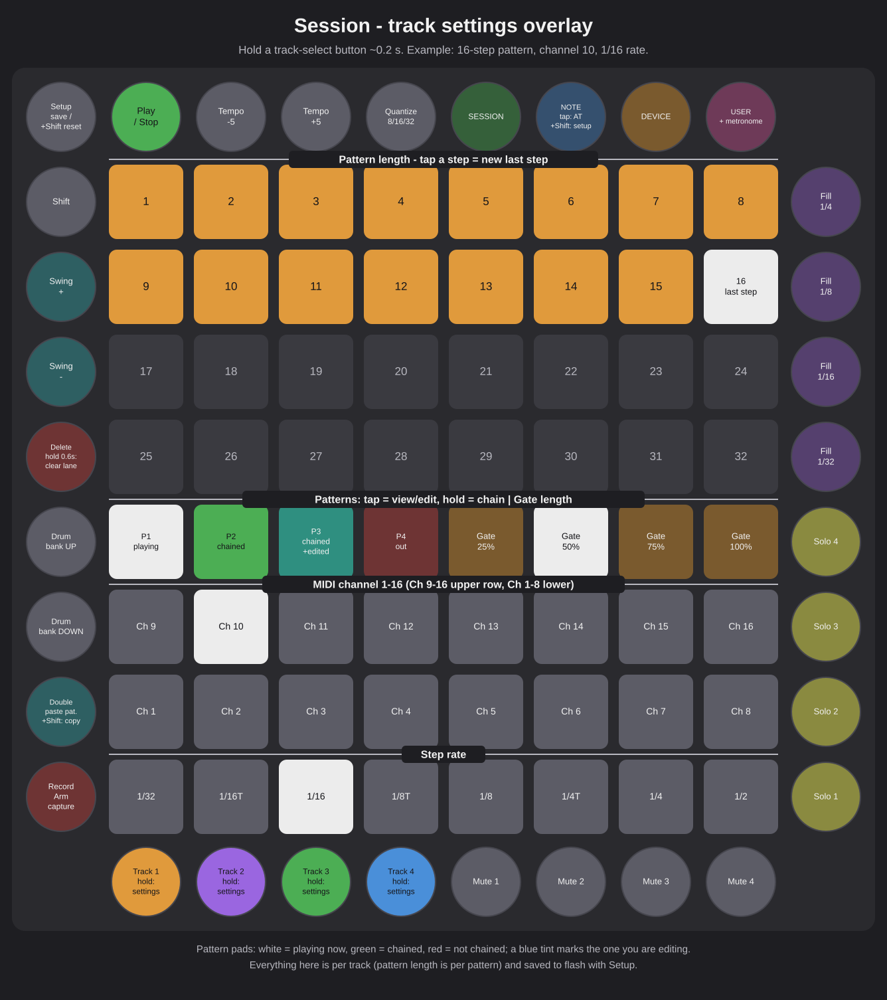
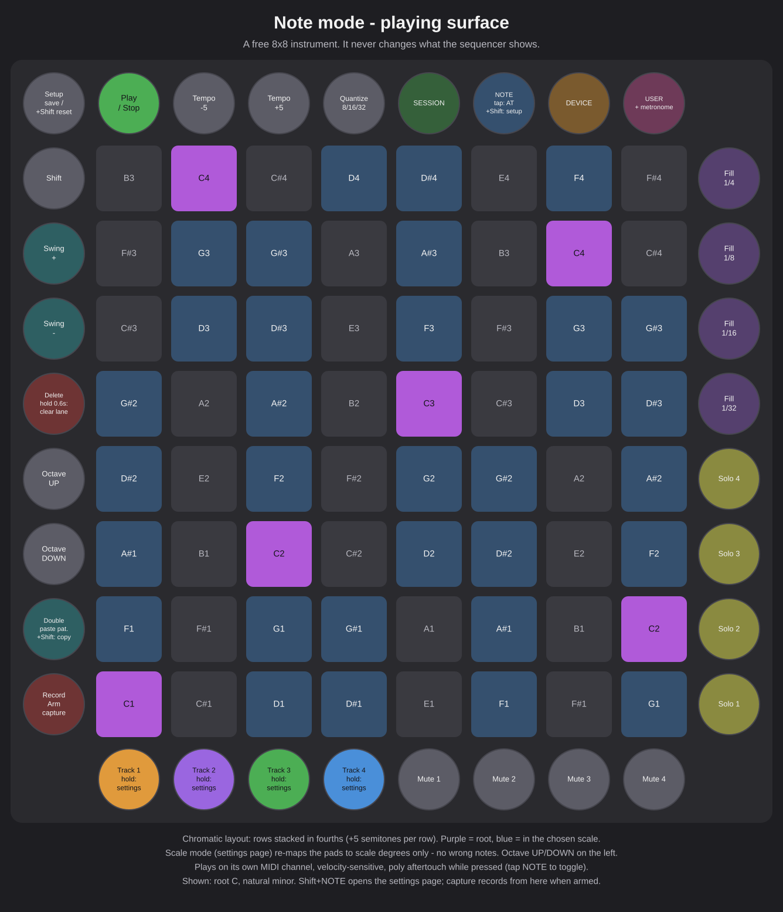
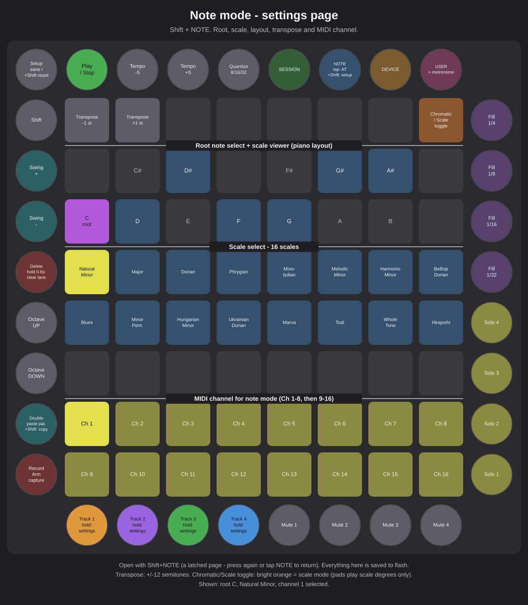
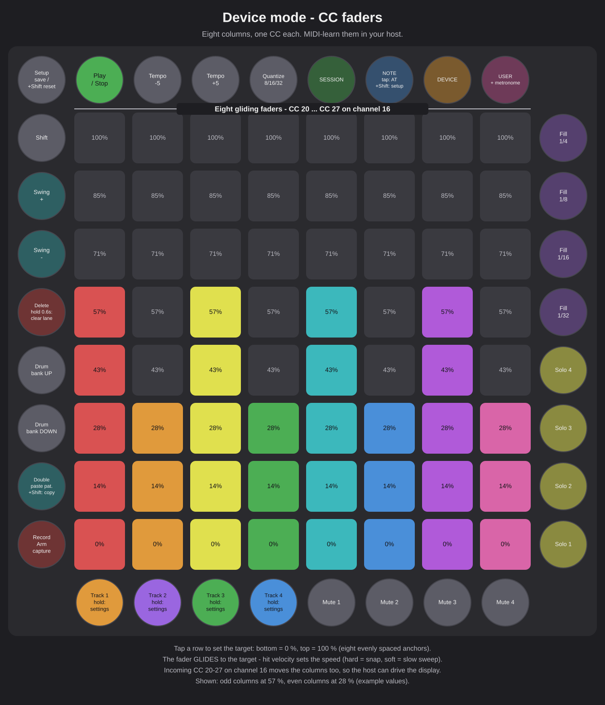
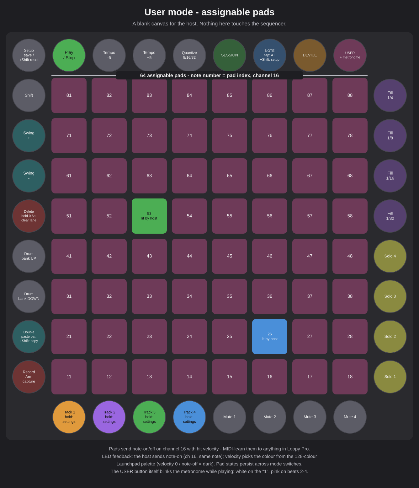

# LaunchStep

Current version: **v1.0**

Custom firmware for the **Novation Launchpad Pro Mk1** that turns it into an
XOX-style step sequencer modelled on the Launchpad Pro Mk3's built-in
sequencer: steps live on the main grid (not the outer ring), and the unit
sequences external gear over USB and DIN MIDI, fully standalone.

Built on [Novation's open firmware framework](https://github.com/dvhdr/launchpad-pro)
(see [docs/UPSTREAM-README.md](docs/UPSTREAM-README.md) for framework details).

## Current state

A full-featured standalone drum sequencer:

- 4 polyphonic tracks × up to 32 steps: every step holds up to 6 notes,
  each with its **own velocity, nudge and probability** — lanes are fully
  independent
- **Polymeter**: every track has its own step rate — 32nd, 16th triplet,
  16th, 8th triplet, 8th, quarter triplet, quarter or half note — and every
  pattern its own loop length (1–32 steps), with an independent playhead
  per track. Steps beyond the length stay dark but editable
- **4 patterns per track with chaining**: each track holds 4 patterns
  (notes, velocities, nudges, probabilities and length each); the chain
  selects which of them the track cycles through, advancing at each
  pattern end
- **The track settings overlay — hold a track-select button**: step rows
  show/set the pattern length (tap = new last step, white marker); row 4
  left = patterns (tap = view/edit one, hold = chain toggle; white =
  playing, green = chained, red = out, blue tint = edited); row 4 right = gate
  length (25/50/75/100 % of a step); rows 3–2 = MIDI channel 1–16; bottom
  row = step rate. All per track, all saved
- **Step probability**: hold a step (or several) — the drum-pad 4×4
  becomes a 16-level probability scale (1/16 … 16/16); tap to set the
  chance the shown lane's note fires each pass (per note — other notes on
  the same step are unaffected)
- **Swing** on left round buttons 60/70 (global, 0–6, up-button brightness
  shows the amount): delays every off-step, scaled to each track's rate
- Mk3-style note lanes: the step grid shows one note at a time. Hit a drum
  pad (e.g. the kick) and the grid shows/edits only that note's steps; pick
  another (the snare) and only its steps appear — everything plays
  together, you just edit one lane at a time. Each track remembers its
  last-selected lane
- Drum pads on the lower-left 4×4: 16 chromatic notes from C1 (36) in
  drum-rack order, bank-shiftable ±16 notes with the bank remembered **per
  track** — matched to drum plugins like those in Loopy Pro. Hitting a pad
  plays the note live and selects its lane. With a velocity level selected the pads play machine-flat at that
  level; in dynamic mode they are fully velocity-sensitive and stream
  polyphonic aftertouch while pressed. The shown lane is highlighted in the
  track colour, pads with steps placed anywhere in the track are marked
  dimmer, Cs dimmest
- Velocity selector on the lower-right 4×4: 16 levels from ghost (7) to full
  (127). New steps are entered at the selected level — and **holding a step**
  (or several) **while tapping a level** edits those steps' velocity in place
  (adding the note if missing) without toggling them; the held step's current
  level shows in white
- Dynamic velocity mode: tap the selected level again to turn the selector
  **off** — the whole velocity grid re-tints to red (the "dynamics"
  colour, distinct from every track colour), and every
  punched step then takes the velocity of the actual pad hit. Tap any level
  to return to fixed mode
- Calm LEDs: rendering is event-driven and diffed against a shadow
  framebuffer, and full repaints are sliced across 1ms ticks so the HAL's
  unbuffered LED scan is disturbed as little as possible
- Internal clock (40–240 BPM) sending MIDI clock + START/STOP, with
  automatic slave mode: whenever external MIDI clock pulses arrive (from a
  DAW, Loopy Pro, hardware — no START message required), they take over the
  timing completely, so the sequencer cannot drift against the master. The
  play button turns amber while slaved; if the clock stream dies, the
  internal clock resumes seamlessly
- Full MIDI transport semantics: START restarts, STOP pauses in place, and
  CONTINUE resumes — honouring a received Song Position Pointer, so the
  master can drop back in mid-song. **Bar-quantized start** while slaved:
  press play while stopped and the pattern starts exactly on the master's
  next "1" (play button white while pending; press again to cancel)
- Notes sent on USB ("standalone" port) and DIN MIDI simultaneously;
  defaults: GM drums (kick 36 / snare 38 / closed hat 42 / open hat 46,
  `DEFAULT_NOTES` in [src/seq/engine.c](src/seq/engine.c)) on channel 10
  (`SEQ_DEFAULT_CHANNEL` in [src/seq/config.h](src/seq/config.h))
- Beat repeat / fill on the right-column buttons beside the step rows
  (bottom-up: 1/32, 1/16, 1/8, 1/4): while active, every track retriggers
  its most recent step at that rate — rolls, stutters, hat bursts. Fills
  always end **exactly on the "1"**: tap latches until the next bar line,
  holding continues across it, and the pattern resumes seamlessly
- Note nudge: hold a step (or several) and tap bank ▲/▼ to shift it off
  the grid, −2…+3 clock ticks (a tick is 1/96 note; +3 = a 32nd late).
  Nudge is per note (the shown lane only); nudged steps get a white lift
  in the grid
- Capture quantize on top button 94, cycling 8th (blue) → 16th (white) →
  32nd (amber), applied relative to the selected track's own step grid;
  finer-than-step hits land as a step nudged late
- Track mute (bottom round buttons 5–8, beside track select) and solo
  (right-column buttons next to the lower grid half, bottom-up): muted
  tracks go dark, soloed tracks glow yellow, and when anything is soloed
  only soloed tracks play — built for live muting with Loopy
- Capture (record) mode on the physical **Record Arm** button: while armed
  and playing, incoming MIDI notes — a Loopy Pro MIDI clip, another
  sequencer, the drum pads, or the note-mode surface — are quantized to the
  selected grid and written into the selected track. Capture disarms
  itself after one full pass of the selected track's pattern. The physical
  **Delete** button (held ~0.6 s) clears the shown note lane
- Everything saved to onboard flash (Setup button) and restored at
  power-up: all patterns with velocities, nudges, probabilities and
  lengths, chains, tempo, swing, entry velocity (or dynamic mode), capture
  quantize, and per-track channel, mute, solo, lane, drum bank, rate and
  gate — stored sparsely. The 1 KB flash area holds roughly 300 placed
  notes across all patterns; beyond that, whole patterns are dropped from
  the save (never corrupted) — the sysex project dump on the roadmap is
  the real fix for very dense projects

## Modes (top-right buttons: Session · Note · Device · User)

The sequencer engine, transport, sync, fills and all side buttons stay live
in every mode — only the 8×8 grid changes function:

- **Session (95)**: the step sequencer, as laid out below
- **Note (96)**: full 8×8 playing surface — chromatic or scale mode, with
  root/scale/transpose/octave and its own MIDI channel on a settings page
  (**Shift + Note** to open/close). Velocity + polyphonic aftertouch
  (tap Note to toggle, button bright = on). Capture records from it
- **Device (97)**: 8 gliding column faders on CC 20–27, channel 16.
  Bottom row = 0 %, top row = 100 %; the fader glides to the tapped row at
  a speed set by how hard you hit the pad (hard = snap, soft = slow sweep).
  Incoming CC 20–27 on channel 16 moves the columns, so Loopy can drive
  the display too
- **User (98)**: 64 neutral pads for MIDI-learn in Loopy Pro. Pads send
  notes (note number = pad index 11–88, programmer-layout convention) on
  channel 16 with velocity; Loopy's LED feedback comes back as note-ons on
  channel 16 whose velocity selects a colour from the (approximated)
  standard 128-colour Launchpad palette

Channel 16 is reserved for this control traffic and is excluded from
capture, so LED/fader feedback can never be recorded into patterns.

## Surface maps

Labelled diagrams of every view, Launchpad-manual style (regenerate with
`python tools/make_graphics.py`):















## Control reference

```
        ┌──────────────────────────────┐
 top    │ ▶ play  − tempo  + tempo  Q  │  then: Session Note Device User
        ├──────────────────────────────┤
 rows   │ steps  1–8                   │  right column rows 8..5 =
 8..5   │ steps  9–16                  │  beat repeat (¼ ⅛ 1/16 1/32,
        │ steps 17–24                  │  top-down)
        │ steps 25–32                  │
        ├──────────────────────────────┤
 rows   │ drum pads    │  velocity     │  left 4×4: C1-chromatic drum-rack
 4..1   │ (4×4)        │  selector     │  order — right 4×4: entry velocity
        ├──────────────────────────────┤
 bottom │ ● ● ● ●  track select 1–4    │  round buttons, track colours
        │ ● ● ● ●  track mute 5–8      │  dark = muted
        └──────────────────────────────┘
          right column rows 1–4 = solo · Setup = save to flash
```

### Global — side buttons, active in every mode

| Button | Function |
| --- | --- |
| Play (91) | Internal clock: toggle start/stop, sends MIDI START/STOP. Slaved + stopped: arms a bar-quantized start (white; press again cancels). Slaved + playing: stops immediately. LED: bright green = playing, amber = playing slaved, dim green = stopped, dim amber = stopped with external clock present, white = start pending |
| Tempo − / + (92 / 93) | BPM ±5, range 40–240 (internal clock only; ignored while slaved) |
| Q (94) | Capture quantize: 8th (blue) → 16th (white) → 32nd (amber) |
| Session / Note / Device / User (95–98) | Mode select, active one bright. Tap = switch and stay; **hold ≥ ~0.3 s = momentary** — the mode reverts to the previous one on release (all four buttons, Note included). **Shift + Note = note settings page** (scales/root/transpose/channel; press again or tap Note to close). In Note mode, a plain Note tap toggles aftertouch. **The User button doubles as a metronome** while playing: white flash on the "1", pink on beats 2–4 |
| Shift (80) | Held: drum pads select their note lane **silently** (nothing is sent or captured) — for programming without triggering sounds. Also chords: Shift+Note = note settings page, Shift+Double = copy pattern, Shift+Setup = total reset |
| Swing + (70) | Swing up (0–6); button brightness shows the amount |
| Swing − (60) | Swing down |
| Delete (50) | **Hold ~0.6 s** to clear the shown note lane from the selected track's **viewed (edit) pattern** — red while holding, green when the clear fires; release early to abort |
| Bank ▲ / ▼ (40 / 30) | Session: drum bank ±16 notes (per track). Note mode: octave ±1 (−2…+4). **While step(s) held**: nudge those steps ±1 tick (−2…+3) |
| Double (20) | Pattern clipboard: **Shift + Double = copy** the viewed pattern (a snapshot — notes, velocities, nudges, probabilities, length); **Double = paste** it into the currently viewed pattern of any track. Cyan when the clipboard holds a pattern |
| Record Arm (10) | Toggle capture (bright red = armed). Auto-disarms after one full pass of the selected track's pattern |
| Track 1–4 (bottom 1–4) | Tap = select track. **Hold ~0.2 s = track settings overlay** (see below) |
| Mute 1–4 (bottom 5–8) | Toggle mute (dark = muted); takes effect at the next step |
| Solo 1–4 (right column rows 1–4, bottom-up) | Toggle solo (bright yellow); when any solo is on, only soloed tracks play; mute still wins |
| Fill (right column rows 5–8, bottom-up) | Beat repeat at 1/32, 1/16, 1/8, 1/4: every track retriggers its most recent step at that rate. Tap = latched until the next bar "1"; hold = continues across bars, still ends on a "1" after release. Active rate bright purple. Press another rate mid-fill to switch |
| Setup | Save everything to flash (green; restored at power-up). **Shift + Setup held ~0.6 s = total reset** — wipes all patterns and settings back to defaults (dim red while arming, bright red when it fires). The flash save is untouched, so a power-cycle restores the last save |

### Session mode — the 8×8 grid

**Step rows (8..5, 32 steps)** — the selected track's viewed pattern,
showing one note lane at a time:

- Tap a step: toggle the shown note there — fixed mode enters it at the
  selected velocity, dynamic mode at the strength of your hit
- Playhead white, uniform dim background on empty steps, step brightness
  follows velocity, nudged steps get a white lift, steps beyond the
  pattern length are dark (still editable)
- **Hold step(s) for ~0.2 s, then** (the delay keeps quick taps from
  flashing the editing views):
  - tap a **velocity pad** → set those steps to that level (adds the note
    where missing); the held step's current level shows white on the grid
  - tap a **drum pad** → the left 4×4 is now a probability scale
    (bottom-left 1/16 … top-right 16/16, current white, filled amber);
    sets the chance the shown lane's note fires each pass (per note)
  - tap **bank ▲/▼** → nudge ±1 tick off the grid
  - once the hold has engaged, releasing without editing does **nothing**
    — safe for peeking at a step's velocity/probability. Only quick,
    unedited taps toggle a step

**Drum pads (lower-left 4×4)** — 16 chromatic notes from C1 in drum-rack
order (bank-shiftable, per track):

- Hit: plays the note live on the track's channel *and* selects its lane.
  Fixed mode plays at the selected level; dynamic mode is
  velocity-sensitive and streams polyphonic aftertouch while pressed
- Colours: white = held, full track colour = shown lane, dim track colour
  = note has steps somewhere in the track, blue-ish = Cs, dim cyan = the
  rest (the cyan base sets the drum area apart from the velocity grid)

**Velocity selector (lower-right 4×4)** — 16 levels, 7…127, gradient
display:

- Tap: select the entry level (track colour). Tap the selected level
  again: **dynamic mode** (selector off, grid tints to red) —
  steps then record your actual hit strength
- While steps are held, taps edit them instead (selection unchanged)

**Track settings overlay (hold a track button ~0.2 s)**:

| Grid area | Function |
| --- | --- |
| Step rows 8..5 | Pattern length: tap = new last step (white); loop lit in track colour |
| Row 4, pads 1–4 | Patterns: **tap = view/edit that pattern**; **hold ~0.3 s = toggle it in/out of the chain**. Colours: **green = chained, red = not chained, blue tint = the one you're editing, white = playing now** (at least one stays chained). The playhead only shows while viewing the playing pattern; capture always records into the playing one |
| Row 4, pads 5–8 | Gate length: 25 / 50 / 75 / 100 % of a step (current white) |
| Rows 3–2 | MIDI channel 1–16 (current white) |
| Row 1 | Step rate: 32nd · 16th-triplet · 16th · 8th-triplet · 8th · ¼-triplet · ¼ · ½ (current white) |

### Note mode — 8×8 playing surface

- Two layouts: **chromatic** (rows stacked in fourths, +5 per row; root
  purple, in-scale notes blue, others dim) and **scale mode** (pads are
  scale degrees only — no wrong notes; rows a 4th of degrees apart, roots
  purple). Octave ± on bank ▲/▼ (−2…+4)
- Velocity-sensitive, sends on **note mode's own MIDI channel**;
  polyphonic aftertouch while pressed when enabled (tap Note to toggle)
- A free playing surface: it does **not** change the sequencer's shown
  note lane; capture still records from here when armed

**Note settings page — Shift + Note** (a latched view: press Shift+Note
again or tap Note to return to playing; switching modes also closes it;
everything here is saved to flash):

| Grid area | Function |
| --- | --- |
| Top row, pads 1–2 | Transpose − / + in semitones (±12; lit brighter when shifted) |
| Top row, pad 8 | **Chromatic / scale-mode toggle** (orange, bright = scale mode) |
| Rows 7–6 | Piano-style **root note select** + scale viewer: naturals on the lower row, sharps above; root purple, in-scale blue |
| Rows 5–4 | **16 scales**: Natural Minor, Major, Dorian, Phrygian, Mixolydian, Melodic Minor, Harmonic Minor, BeBop Dorian, then Blues, Minor Pentatonic, Hungarian Minor, Ukrainian Dorian, Marva, Todi, Whole Tone, Hirajoshi (selected bright) |
| Rows 2–1 | **MIDI channel 1–16** for note mode (selected bright) |

### Device mode — 8 column faders

- Sends CC 20–27 on channel 16, one CC per column
- Tap a row: bottom = 0 %, top = 100 %; the fader **glides** to the target
  at a speed set by hit velocity (hard = snap, soft = slow sweep)
- Incoming CC 20–27 on channel 16 moves the columns (bidirectional with
  Loopy)

### User mode — 64 assignable pads

- Pads send note-on/off on channel 16, note number = pad index (11–88,
  programmer-layout convention), with hit velocity — MIDI-learn them in
  Loopy Pro
- LED feedback: incoming note-on (channel 16, same note) lights the pad;
  velocity picks the colour from the approximated 128-colour Launchpad
  palette; note-off or velocity 0 turns it off. States persist across mode
  switches

### MIDI summary (for testing)

- **Out** (USB "standalone" port + DIN, always both): sequenced notes on
  each track's channel; MIDI clock + START/STOP while playing internally
  (never while slaved); live pad/keyboard notes; poly aftertouch;
  device faders and user pads on channel 16
- **In** (any port): MIDI clock / START / STOP / CONTINUE / Song Position
  Pointer drive sync and transport; note-ons feed capture when armed;
  channel 16 is reserved (user-pad LEDs + fader CCs) and never captured

## Building (Windows, no make/Docker needed)

```bash
./setup-toolchain.ps1
```

```bash
./build.ps1
```

`setup-toolchain.ps1` downloads the portable xPack ARM GCC toolchain into
`.\toolchain` (checksum-verified, nothing installed system-wide). `build.ps1`
produces **`build\launchstep.syx`**. Python 3 must be on PATH (it drives
[tools/hextosyx.py](tools/hextosyx.py), a port of the upstream C++ converter).

On Linux/macOS the upstream `Makefile` still works (`make`, or via the
provided Dockerfile) and now includes the LaunchStep sources.

## Flashing

1. Unplug the Launchpad Pro
2. Hold **Setup** while plugging the USB cable back in — the unit boots into
   its bootloader (a pad grid pattern appears)
3. Send `build\launchstep.syx` to the device's MIDI port with a sysex tool —
   on Windows e.g. [MIDI-OX](http://www.midiox.com/) (set the sysex delay low)
4. The grid scrolls "upgrading...", then reboots into LaunchStep

**This cannot brick the unit.** The bootloader is write-protected. To return
to the factory firmware, repeat the same procedure with
`resources/Launchpad Pro-1.0.154.syx` from this repo.

## Using with Loopy Pro

Sync: enable MIDI clock sending to the Launchpad in Loopy Pro's MIDI
settings — the sequencer follows automatically (amber play button), with or
without transport messages.

Round-tripping MIDI clips (Loopy Pro 2.0+): Loopy has no protocol for
pushing clip *contents* to hardware, but capture mode gets close:

1. Route the MIDI clip's output to the Launchpad
2. Arm capture (**Record Arm**), press play if not already running
3. Trigger the clip in Loopy — after one 2-bar pass its notes sit in the
   step grid (keys with captured notes light up on the keyboard)
4. Disarm, edit lanes/steps as usual
5. To get the edits back: record the Launchpad's MIDI output into a Loopy
   MIDI clip

Capture limits: notes are quantized to the selected grid, clips longer
than the selected track's loop fold onto its steps, note lengths are
replaced by the sequencer's own gate, and a step tops out at 6 notes.

## Known limitations

- **Disable MIDI echo/thru back to the LaunchPad** in your host: the
  firmware reads all input ports, so an echoed clock could false-slave
  the transport and echoed notes would be re-captured while recording
- **Saving stalls the sequencer for a moment**: the flash write in the
  Setup press runs synchronously, so save while stopped when timing
  matters; unplugging right after pressing Setup can tear the save
- **DIN MIDI is slow** (31.25 kbaud): many simultaneous notes across all
  tracks can smear timing on the DIN output; USB is unaffected
- The flash save holds ~300 placed notes; denser projects drop whole
  patterns from the save (the in-memory project is never affected)

## Roadmap (toward Mk3 parity)

- [x] Note-entry keyboard on the lower grid half
- [x] Per-step velocity editing (hold step + tap a velocity level)
- [x] Per-track pattern length and step rate (polymeter / polyrhythm)
- [x] Multiple patterns per track with chaining
- [x] Track mute/solo from the surface
- [x] Per-track MIDI channel editing from the surface
- [x] Micro-timing (per-step nudge) and global swing
- [x] Step probability
- [x] Proper MIDI CONTINUE handling (Song Position Pointer honoured)
- [x] Gate length control (per track)
- [x] Bar-quantized start while slaved; capture auto-disarm
- [ ] Pattern dump/restore over sysex (the 1 KB flash user area is the only
      onboard storage, so large projects need a computer round-trip)
- [x] Pattern copy/paste between slots (Shift+Double / Double)

## Code tour

| File | Role |
| --- | --- |
| [src/app.c](src/app.c) | HAL callbacks, wiring only |
| [src/seq/config.h](src/seq/config.h) | All tunables: tracks, tempo, ports, defaults |
| [src/seq/layout.h](src/seq/layout.h) | Pad-index math and button assignments |
| [src/seq/clock.c](src/seq/clock.c) | Internal 24 PPQN clock + external sync |
| [src/seq/engine.c](src/seq/engine.c) | Pattern model, per-track playheads, nudge scheduler, fills |
| [src/seq/ui.c](src/seq/ui.c) | Modes, LED rendering (event-driven, shadow-buffered), input |
| [src/seq/store.c](src/seq/store.c) | Save/load to the flash user area |

## License

BSD 3-clause, inherited from the upstream framework — see [LICENSE](LICENSE).
